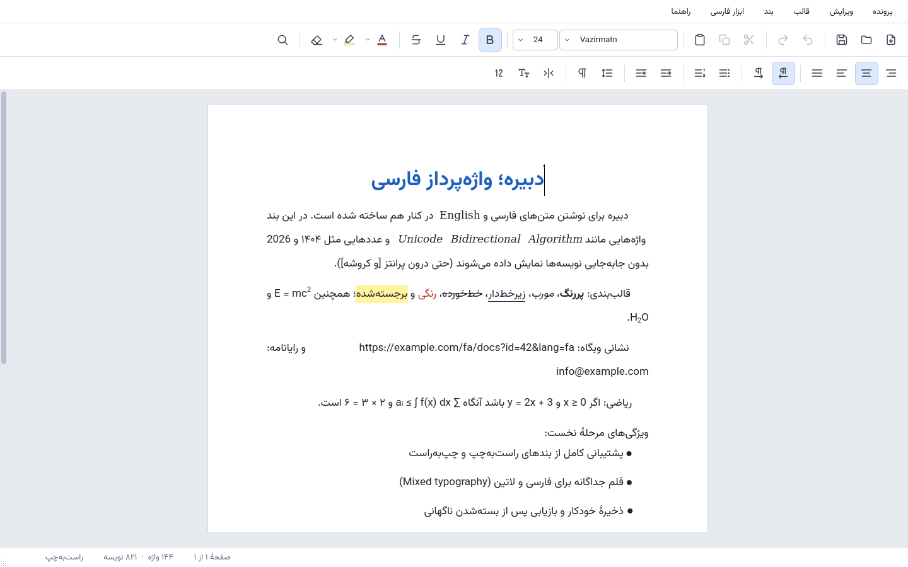

# دبیره (Dabireh) — Phase 1 + Phase 2

A desktop word processor for Persian and mixed-direction documents, written in
Python 3.13 with PySide6 (Qt 6). The interface is Persian and right-to-left.

Phase 1 delivers the desktop foundation and a working rich-text editor with a
structured file format, autosave/recovery and an automated test suite.



## Verification status

| What | Status |
| --- | --- |
| Automated tests | 135 passing (Python 3.13.18, PySide6 6.12, Linux, Qt `offscreen` platform) |
| Application start-up (`run()` → window → open file → close) | exercised headless on Linux |
| Visual check of rendered window, dialogs and exported PDF | done by inspecting real renders (see `docs/screenshots`) |
| **Running on Windows** | **not yet done** — the code uses only cross-platform Qt/Python APIs plus guarded Windows integration, but nobody has launched it on Windows |
| PyInstaller build (`dabireh.spec`) | recipe provided, **not built or tested** |

## Install and run

```bash
python -m venv .venv
.venv\Scripts\activate            # Windows   (Linux/macOS: source .venv/bin/activate)
pip install -r requirements.txt
python main.py                    # or: python main.py path\to\document.dbr
```

Run the tests:

```bash
python -m pytest
```

Regenerate the screenshots used for visual review (headless, real widgets):

```bash
python tools/render_preview.py docs/screenshots
```

On a minimal Linux machine Qt also needs `libxkbcommon0`, `libegl1`, `libgl1`
and `libfontconfig1`. The Vazirmatn font (SIL OFL) is bundled in
`resources/fonts`, so Persian text renders the same on every machine.

User data lives in `%APPDATA%\Dabireh` (settings.json, dabireh.sqlite3,
dabireh.log). Set `DABIREH_HOME` to use another folder.

## Features

**Editing** — bold, italic, underline, strikethrough, superscript/subscript,
font family and size, text colour, highlight, clear formatting; right / centre /
left / justified alignment; RTL / LTR paragraph direction; line spacing,
paragraph spacing, first-line and side indents; bulleted and numbered lists;
undo/redo; cut/copy/paste and paste-without-formatting; find and replace
(whole word, case, Persian/Arabic ی‌/ک tolerant). Toolbar and menus follow the
cursor.

**Persian and bidirectional text**

- Text is stored in logical (typing) order. Display order comes only from
  Qt's Unicode Bidirectional Algorithm; no code reverses or reorders characters.
- Each paragraph is RTL, LTR or "document default"; the document default can be
  RTL, LTR or detected from each paragraph's first strong character.
- Alignment and indent buttons are direction-aware (switching a paragraph's
  direction mirrors it, as Word does).
- Half-space (ZWNJ) with `Shift+Space` or `Ctrl+Shift+2`; LRM/RLM insertion;
  "isolate selection as left-to-right" (adds LRI…PDI around a formula or path);
  digit conversion Persian ↔ Latin that keeps formatting.
- Arrow keys move logically by default; visual movement is a toggle in
  «ابزار فارسی».

**Mixed typography** — any selection can have its own font, size and style.
«قالب ‹ اعمال قلم بر پایهٔ خط» sets Persian, Latin and mathematical runs in
the document's three configured fonts (defaults: Vazirmatn / Cambria /
Cambria Math, with fallbacks when a font is not installed).

**Documents** — new, open, save, save as, recent documents, unsaved-change
prompts, metadata and document settings, plain-text import (UTF-8, UTF-16,
Windows-1256), export to PDF, HTML and plain text.

**Pages** — A4 / A5, portrait / landscape, four margins, page background
colour. The document is laid out with the real page size: lines never enter a
page's margins, pages are shown as separate sheets, and the PDF export has the
same page breaks.

**Autosave** — every 30 s (configurable in settings.json), and only after a
pause in typing, the unsaved document is snapshotted; encoding and the SQLite
write happen on a worker thread. Autosave never overwrites your file: it keeps
a recovery copy that is deleted on save/discard and offered at next start-up
after a crash («پرونده ‹ بازیابی سندهای ذخیره‌نشده»).

**Safety** — files are written to a temporary file, flushed and atomically
renamed, so a failed save leaves the previous version intact; a failed save or
open keeps the current document open and modified; unexpected errors are logged
and trigger an emergency recovery snapshot.

## File format (`.dbr`)

UTF-8 JSON, versioned (`"format": "dabireh-document", "version": 1`):
metadata, page settings, document defaults, and a list of paragraphs; each
paragraph has a style, optional list membership and styled text runs. The model
(`core/document.py`) has no Qt dependency. Pasted content is converted through
the same model, so the editor never shows something it cannot save (text inside
pasted tables is kept as paragraphs; images are dropped).

## Architecture

```
main.py                 entry point
app/                    start-up, main window, settings (JSON), autosave controller, service wiring
editor/                 editing engine on QTextDocument
  page_view.py            paged QTextEdit (page geometry, sheet rendering, page numbers)
  text_editor.py          the editor widget: commands, clipboard, key handling
  formatting.py           cursor-level formatting commands and state queries
  qt_bridge.py            QTextDocument <-> document model
  find_replace.py, export.py, toolbar.py (actions + toolbars), shortcuts.py
core/                   Qt-free logic
  document.py             document model + file format
  bidi.py, persian.py     direction detection, bidi controls, digits, search, Jalali dates
  typography.py           script runs and per-script fonts
  pagination.py, units.py page geometry and unit conversion
storage/                SQLite database, document repository (atomic I/O), recent files, autosave store
ui/                     theme (design tokens + stylesheet), SVG icon set, components, dialogs
resources/              bundled fonts and stylesheet images
tests/                  pytest suite and Persian sample documents
tools/                  sample-document generator, screenshot renderer
```

Dependencies point one way: `app → editor/ui → core`, `app → storage → core`.

## Tests

| File | Covers |
| --- | --- |
| `test_bidi.py` | Persian shaping (joined glyphs, half-space), mixed Persian/English, Persian/Latin/Arabic digits, bracket mirroring, formulas, punctuation, URLs, e-mail, logical text integrity, paragraph direction |
| `test_editor.py` | typing, undo/redo, cursor navigation (logical and visual), keyboard selection, copy/cut/paste, HTML paste, find/replace, digit and isolate tools, pagination |
| `test_formatting.py` | character formats, mixed typography, script fonts, alignment, direction, spacing, indents, lists |
| `test_storage.py` | save/reopen round trip, atomic save, bad files, legacy encodings, recent files, settings, autosave, crash recovery, unsaved-change protection |
| `test_ui.py` | Persian RTL interface, every command wired, toolbar clicks and sync, shortcuts, dialogs, exports, pixel checks of rendered text position, rendering at three window sizes |
| `test_core.py` | Qt-free helpers, model validation, page geometry |

The bidi tests read glyph ids and glyph positions from Qt's layout, i.e. what
will be drawn, not just the stored string. They still cannot judge whether the
result *looks* right to a reader; for that, review the images from
`tools/render_preview.py` and, on Windows, the manual checklist below.

### Manual checklist for the first Windows run

1. Type Persian with the standard Persian keyboard; try `Shift+Space`.
2. Type `سلام Hello دنیا (۱۲۳) test@example.com` and move through it with the arrow keys, in both cursor modes.
3. Select across the Persian/English boundary with Shift+arrows and with the mouse.
4. Copy from/to Microsoft Word and a browser.
5. Check font rendering at 100 %, 125 % and 150 % display scaling.
6. Kill the process from Task Manager after typing for 40 s, restart, and recover.

## Known limitations

- **Not yet run on Windows** (see the table above). Windows-only details —
  taskbar identity, native file dialogs, DPI scaling, Cambria fonts — are
  untested.
- **Pagination is basic.** Page breaks come from Qt's document layout. There
  are no headers/footers, page numbers, manual page breaks, sections, columns,
  or widow/orphan control, and no zoom. `core/pagination.py` and
  `editor/page_view.py` isolate page geometry so a custom engine can replace it.
- **No tables, images, footnotes, styles gallery, comments or track changes**, and no DOCX/ODT import or export.
- Numbered lists use Latin digits (Qt's built-in list numbering); only one list level is exposed in the UI.
- Changing page setup clears the undo history (page setup itself is not undoable).
- Page background colour is shown on screen but not written to the PDF.
- Justified Persian text uses Qt's justification (it may stretch with kashida).
- Per-script fonts are applied on demand, not automatically while typing.
- The colour picker's "more colours" dialog and file dialogs use Qt/OS built-in text (not translated here).
- Running two instances at once: the second one will offer the first one's unsaved autosave snapshot for recovery.
- No print dialog yet; print via the exported PDF.

## Working with images

Insert an image from «درج ← تصویر» (or paste/drag one into the document).
Double-click it or use «درج ← ویژگی‌های شیء انتخاب‌شده» to adjust its size,
rotation, crop, border and placement. The dialog includes a preview and a
button to fit the image within the page margins. Choose «جدا از متن» and
right, centre or left alignment to place the image in its own paragraph, with
text above and below it. The surrounding text is preserved; typing continues
in a paragraph below. Inline and floating left/right modes remain available.
Images are anchored to the text rather than freely draggable around the page.

## Appearance

Choose a light, warm or dark application theme in «نمایش ← پوستهٔ برنامه».
The choice is saved immediately. Themes change the interface and workspace,
not the document's page colour or its exported content. The «نمایش» menu also
lets you hide or restore each toolbar.

## Keyboard shortcuts

Press `F1` in the app for the full list. Main ones: `Ctrl+N/O/S`, `Ctrl+Shift+S`,
`Ctrl+Z/Y`, `Ctrl+F/H`, `Ctrl+B/I/U`, `Ctrl+Shift+X` (strikethrough),
`Ctrl+R/E/L/J` (align right / centre / left / justify), `Ctrl+Shift+R` /
`Ctrl+Shift+L` (paragraph RTL / LTR), `Ctrl+Shift+8` / `Ctrl+Shift+7` (lists),
`Ctrl+M` / `Ctrl+Shift+M` (indent), `Ctrl+1/5/2` (line spacing), `Ctrl+\`
(clear formatting), `Ctrl+Shift+V` (paste as plain text), `Ctrl+Shift+P` (PDF).


---

# Phase 2 (version 0.2.0)

Phase 2 adds objects, tables, styles, references, printing, interchange formats,
templates and document management on top of the Phase 1 editor. Everything
below was exercised by the automated tests on Linux (Qt "offscreen" platform,
Python 3.13, PySide6 6.12). **It has not been run on Windows**, the PyInstaller
build is still unbuilt, and the DOCX/RTF output has not been opened in
Microsoft Word (DOCX is verified by reading it back with python-docx and with
the built-in importer).

Samples: `docs/samples/feature_sample.{dbr,pdf,docx}`; screenshots in
`docs/screenshots/` (`feature_window.png`, `feature_page.png`,
`equation_dialog.png`, `table_dialog.png`). Regenerate with
`python tools/build_feature_document.py`.

## What was added

| Area | Features |
|---|---|
| Characters | letter spacing, horizontal scale, underline styles (single, dash, dot, wave), format copy/paste and format painter |
| Paragraphs | background colour, page break before, hanging indent, spacing presets, extra list styles (hollow circle, square, letters, roman) |
| Styles | built-in Title, Subtitle, Heading 1–3, Quote, Caption…; create, edit, delete user styles; style box in the toolbar; editing a style restyles its paragraphs |
| Page | A4, A5, Letter, Legal, custom size; page border; header and footer with `{page} {pages} {date} {time} {title}`, different first page and odd/even pages, Persian/Latin/roman numbers |
| Tables | insert, RTL and LTR column order, Tab/Shift+Tab navigation, insert/remove rows and columns, merge/split, cell colour and vertical alignment, header rows, column widths, borders, tables that break across pages |
| Images | PNG, JPEG, WebP, SVG, BMP, GIF; file dialog, paste and drag-and-drop; resize with locked aspect ratio, rotate, crop, border, replace, inline or floating left/right with text wrap. Images are stored once inside the `.dbr` file |
| Shapes | line, arrow, connector, rectangle, rounded rectangle, ellipse, circle, polygon, callout, text box; fill, stroke, opacity, rotation, text; group, ungroup, order inside a group |
| Equations | LaTeX input with live preview and a symbol palette; inline and display equations, automatic numbering; editable by double click; exported to Word as native (OMML) equations |
| References | table of contents, list of figures, list of tables, numbered captions, end notes, hyperlinks, bookmarks, cross-references, go to page |
| Search | find/replace can be limited to bold, italic, underlined, highlighted or linked text |
| Output | PDF, PNG and SVG (one file per page), printing with page selection and scaling, print preview, HTML, DOCX, RTF, plain text. Screen, PDF, images and printer all paint through the same page renderer, so page breaks are identical |
| Import | DOCX (text, formatting, lists, tables, images, links, notes, equations, page setup, header/footer) |
| Templates | general, school notes, lecture notes, mathematics notes, scientific report, research paper, formal letter; save any document as your own template |
| Management | version history per file, backup of the previous file content before every overwrite, export log, autosave settings, document statistics |
| Shortcuts | every command can be given a different key in «راهنما ← تنظیم میان‌برها»; conflicts are reported |

## Phase 2 limitations (not implemented)

- **Not in the document model:** double underline, borders around text or
  paragraphs, keep-with-next / keep-lines-together (a heading can be left alone
  at the bottom of a page), multiple columns, sections with their own page
  setup or headers, page background image, citations and bibliography.
- **Notes are end notes only**: they are collected in a «پی‌نوشت‌ها» list at
  the end of the document; there are no per-page footnotes.
- **Cross-reference text is a snapshot**; it is not refreshed when the target
  heading or number changes. Caption numbers, notes and generated lists are
  refreshed with F9 and automatically before export and printing.
- **Images float left or right only**; there is no free positioning, and shapes
  are always inline with the text.
- **Equations**: a practical LaTeX subset (fractions, scripts, roots, sums,
  integrals, limits, matrices, cases, accents, Greek, common symbols).
  Unsupported commands are shown as red source text. Cambria Math is used when
  installed; the layout was only checked with DejaVu fonts.
- **DOCX export** writes shapes and cropped/rotated images as pictures and
  notes as superscript numbers plus a plain list. **DOCX import** skips text
  boxes, floating drawings, tracked changes and EMF/WMF pictures, and flattens
  nested tables. A `.docx` is opened as an unsaved copy and is never overwritten.
- **RTF export** contains text, formatting and tables; images and shapes are
  left out and equations are written as LaTeX source.
- **Clipboard**: copying between two running Dabireh windows of the *same*
  process keeps tables and objects. When the application quits, clipboard
  content created by the editor is reduced to plain text.
- Version history lives in the application database, not in the `.dbr` file,
  so it does not travel with the file.
- Older backups remain visible after upgrading but are not automatically pruned,
  because their names do not identify the original folder.
- Phase 1 leftover: in a window narrower than the page, the horizontal scroll
  position starts at the left edge of the page.

## Phase 2 tests

`tests/test_phase2.py` (85 tests; 220 in total): model round trips, equation
parsing and OMML, object insertion and editing, RTL/LTR table column order and
Tab order, row/column/merge commands, styles, format painter, page breaks,
table of contents and caption numbering, notes, links and bookmarks,
copy/paste of tables and objects, PDF content (page count, fonts, header and
footer positions), page images, printing to a PDF printer, DOCX round trip,
RTF and HTML output, templates, versions, backups, export log and
configurable shortcuts.

Two defects found by these tests were fixed: copy/paste silently dropped
tables and objects, and refreshing a table of contents merged the following
heading into the list title.
"# dabireh" 
